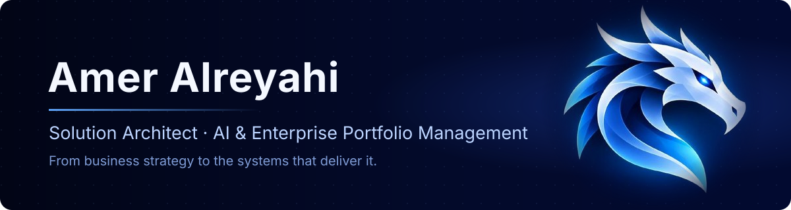
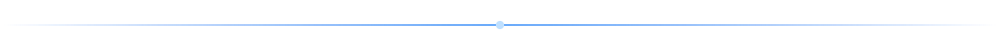

  
  
  
  
  

I'm a solution architect. I design enterprise solutions end to end: from the
business strategy and the project portfolio, through data and integration, down to the AI systems and platforms that
deliver them. My work follows the TOGAF Architecture Development Method. I'm a Broadcom Certified Partner, focused on ValueOps
(Clarity PPM and value stream management).

## Architecture practice

| Layer | What I do |
|---|---|
| **Business** | Capability maps, value streams and portfolio strategy; Broadcom ValueOps value stream management and Clarity PPM. |
| **Data & applications** | Integration architecture across Clarity PPM, Automic Automation and ITSM; agentic AI and custom MCP servers that extend them. |
| **Technology** | Containerized platforms on Linux and Docker; workflow orchestration with Temporal and Automic. |
| **Governance** | Architecture and AI governance, Generative AI and RAG in regulated environments, roadmaps tied to business value. |

## Selected work

| Project | What it is |
|---|---|
| [Stratogen](https://github.com/AmerAlreyahi/Stratogen) | AI-powered project portfolio management: ideas, proposals, projects, risks, dashboards and approval workflows. |
| [ZerOS](https://github.com/AmerAlreyahi/ZerOS-releases) | Turns a Linux PC or Raspberry Pi into a personal server: browser desktop, one-click apps, backups. |
| [SIQE Studio](https://github.com/AmerAlreyahi/Super-Image-Quality-Enhancer) | Self-hosted image upscaling, restoration and model training on your own GPU. |
| [OpenCircle](https://github.com/AmerAlreyahi/OpenCircle) | Circle to Search for Windows and Linux: search, translate the screen, ask AI, snip. Rust. |
| [OptimaMT](https://github.com/AmerAlreyahi/OptimaMT) | 49 translation models optimized for ONNX Runtime: identical output, about half the memory. |
| [AuraFit](https://github.com/AmerAlreyahi/aurafit-releases) · [Hadaf](https://github.com/AmerAlreyahi/Hadaf) · [Birds Eye Finance](https://github.com/AmerAlreyahi/Birds_Eye_Finance) | Android apps for fitness, goals and personal finance, in Arabic and English. |

## Core expertise

- **Enterprise portfolio & value streams:** Broadcom Certified Partner, focused on ValueOps (Clarity PPM, value stream management, agile metrics and strategy); Automic Automation.
- **AI:** generative AI and agents, RAG, deep learning, NLP and computer vision.
- **Platforms:** containers, DevOps and networking.
- **Education:** B.Sc. Computer Science (AI & Data Science), Tafila Technical University, 2024.

## Main tools

The ones I use most, not a complete list.

| Area | |
|---|---|
| **Cloud & platform** |  |
| **Integration & data** |  |
| **Delivery & observability** |  |
| **AI** |    |
| **Applications** |  |

## GitHub stats

  

